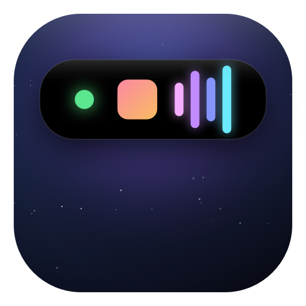
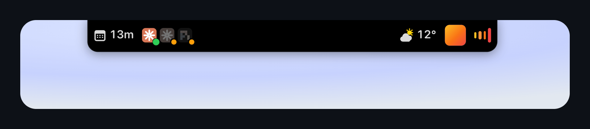
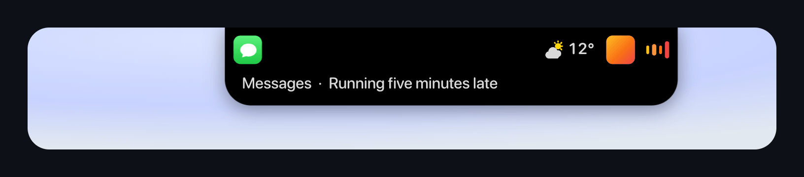
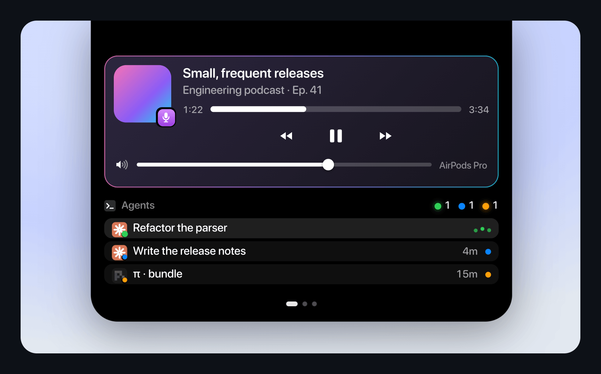

<p align="center"></p>

<h1 align="center">Sylt</h1>

<p align="center">A dynamic island for the MacBook notch: live status in two wings, short overlays when something changes, and an expanded view with controls.</p>

<p align="center">
  
  
  <a href="LICENSE"></a>
  <a href="https://github.com/zenodea/sylt/actions/workflows/ci.yml"></a>
</p>

<p align="center"></p>

## What it shows

Closed, the island shows only live state, each wing sized to its content. An empty side adds nothing. It stays above every window, full-screen apps included.

- **Left:** running agents (working first, idle faded), the next meeting's countdown, a running timer, AeroSpace workspaces, open reminders.
- **Right:** mic and camera dots, the active Focus, headphone charge, the weather, Slack unreads, the time, album art with live audio bars.
- **Menu bar items:** Wi-Fi with its strength, Bluetooth, volume and battery, so the island can stand in for the menu bar.

## Overlays

<p align="center"></p>

Changes grow out of the notch for a moment and fade back. A one-sided overlay leaves the other wing alone, and each kind can be switched off.

| Overlay | Shows |
| --- | --- |
| Volume, brightness, mute | A level bar in the right wing; brightness only for key or island changes, never auto-brightness |
| Track change | The new cover flips in, the title slides out underneath |
| Battery | 80, 60, 40, 20, 15, 10, 5 and 0 percent, and charger changes |
| Bluetooth | Device name and exact charge on connect; warnings at 20 and 10 percent |
| Network | Wi-Fi joined, cable plugged in, or offline |
| Calendar | The next event five minutes before it starts, and at the start |
| Keyboard, Focus | Caps Lock, layout changes, the Focus mode you switched to |
| Mic and camera | When either starts or stops |
| Thermals | Throttling from heat, and cooling down |
| Notifications | Notification Center banners with the app's icon (experimental) |
| Unlock | A padlock springing open with a greeting |
| Plugins | A timer ending, a download landing, an agent finishing |

## Expanded

<p align="center"></p>

Click or swipe down for two sections per page; swipe sideways to turn it. On a wide screen a setting shows two or three pages side by side.

- **Media:** artwork, transport, seek bar, source app, output volume and device.
- **Next event:** a Join button for Zoom, Meet, Teams and Webex links.
- **Plugins:** timer presets, agents (waiting first, with how long), file shelf, clipboard history, weather, workspaces with their apps.

A section's title opens its app, such as Activity Monitor for system load.

## Lock screen

Locked, the island shows a padlock and the time, and stays visible over the login window.

## Make it yours

**Layout pane.** The island drawn above three columns: left wing, right wing, hidden. Drag any badge or plugin between them or onto another tile to reorder; the island follows. A handle between items sets the gap and an optional hairline. The same pane groups expanded sections into pages.

**Effects pane.** Entering the island takes the pointer in: it disappears and the mouse leans the island. A firm push lets it out through the rim on that side, mid-motion. Settings cover the hold and how hard the push must be, a rim glow where it will exit, the exit effect (an adjustable ripple, a ring of light, a reflection across dark glass, or none) and a haptic tap. While held, the pointer stays off the top edge so the menu bar never drops down.

**Menu bar pane.** When macOS hides the menu bar, which Apple status items show, and an optional divider that hides everything to its left until the pointer is up there or the chevron is clicked. Command-drag the divider to move it.

## Plugins

Built-in sources are Swift monitors; everything else is a plugin, a program in any language that prints JSON. Fifteen ship with the app, each can be switched off.

| Plugin | Shows | Plugin | Shows |
| --- | --- | --- | --- |
| Agents | Coding agents, from Herdr or by process | Downloads | Downloads starting and finishing |
| AeroSpace | Workspaces; click to switch | File shelf | Files dropped on the island |
| Ghostty | A quick terminal | Clipboard | Recent copies; click to copy again |
| Slack | Unread mentions, no token | Tailscale | Status, exit node, peers |
| Todos | Open reminders; click to tick off | Mullvad VPN | On or off, and the exit location |
| Clock | The time | Network traffic | Bytes in and out |
| Timer | Countdowns with a chime | System load | CPU, memory and GPU |
| Weather | Conditions, from Open-Meteo | | |

## Writing a plugin

A plugin is a folder with a `plugin.json` and a program. Put it in `~/Library/Application Support/Sylt/Plugins` (Settings has a button for it) and it starts. `Plugins/` holds working examples.

```json
{
  "protocol": 1,
  "id": "coffee",
  "name": "Coffee",
  "description": "Cups so far today.",
  "symbol": "cup.and.saucer.fill",
  "run": "coffee.sh",
  "settings": [{ "key": "goal", "title": "Daily goal", "type": "number", "default": 3 }]
}
```

The program prints one JSON object per line, each replacing one thing, and reads events from stdin:

```sh
#!/bin/sh
read start                               # {"event":"start","settings":{...},"dataDir":"..."}
echo '{"wing": {"side": "right", "items": [{"symbol": "cup.and.saucer.fill", "text": "2"}]}}'
echo '{"hud": {"symbol": "cup.and.saucer.fill", "tint": "orange", "text": "Coffee logged"}}'
echo '{"section": {"title": "Coffee", "rows": [{"id": "log", "title": "Log a cup"}], "buttons": [{"id": "reset", "title": "Reset"}]}}'
while read event; do                     # {"event":"click","row":"log"} {"event":"button","id":"reset"} ...
  case "$event" in *'"click"'*) echo '{"wing": {"side": "right", "items": [{"symbol": "cup.and.saucer.fill", "text": "3"}]}}';; esac
done
```

| Line | Effect |
| --- | --- |
| `wing` | The badge in `side` (`left`, `right`). Items mix `symbol`, `image` (`app:`, `icon:`, `file:`), `text`, `tint`, `dot`, `ring`, `graph` and `status` (`working`, `waiting`); `spacing` sets the gap. Empty items clear it. |
| `hud` | An overlay: `symbol` or `image`, `tint`, `text` or `level`, `side` (`both`, `left`, `right`), `duration`, `sound`, `trailingSymbol`, `trailingTint`. |
| `section` | The expanded section: `title`, `symbol`, `rows`, `files`, `buttons`, `actions`. Rows take `id`, `symbol` or `image`, `title`, `detail`, `trailing`, `trailingTint`, `status`, `progress`, `buttons`, `highlighted`, `large`, `graph`, `tint`. |
| `clearSection` | Removes the section. |
| `sound` | Plays a system sound by name. |
| `activate` | Brings an app forward by `process`, `pid` or `bundle`, raising the window whose title contains `window`. |
| `open` | Opens a path or URL. |

Levels, rings and graph values run from 0 to 1. Tints are `white`, `dim`, `green`, `orange`, `red`, `yellow`, `blue`, `indigo`, `purple`, `pink`, `cyan` or `#hex`.

**Events:** `start` (with `settings`, `dataDir`), `settings`, `click` (row `id`, none for the title), `button`, `action`, `drop` (`files`), `clipboard` (`text`; password managers skipped), `remove` (a file path), `stop`.

**Manifest options:** `interval` (seconds) runs it once per interval instead of continuously. `accepts` (`files`, `clipboard`) subscribes to drops or copies. `opens` (a bundle id) brings that app forward on a title click, or a row click while a one-shot plugin isn't running. `side` sets the starting wing; `enabledByDefault: false` ships it off. `settings` of type `bool`, `text`, `number` or `choice` (with `options`) become a form.

Plugins run as you. A script without the executable bit runs through the interpreter for its extension: `.py`, `.sh`, `.rb`, `.js`, `.swift`.

## Install

macOS 14 or later, on a Mac with a notch.

Download `Sylt-<version>.dmg` from [Releases](https://github.com/zenodea/sylt/releases) and drag Sylt into Applications. The app is not notarised, so macOS blocks the first launch: open it once, then choose **Open Anyway** in System Settings › Privacy & Security. Or clear the quarantine flag:

```sh
xattr -dr com.apple.quarantine /Applications/Sylt.app
```

To build from source instead:

```sh
git clone https://github.com/zenodea/sylt.git
cd sylt
make open        # builds build/Sylt.app and launches it
```

Right-click the island for Settings. Each permission is asked for the first time something needs it:

- **Accessibility** for the volume and brightness keys, mirrored notifications, and raising an agent's terminal.
- **Calendar** for the next event.
- **Bluetooth** for device connections and battery.
- **Automation (Spotify, Music)** for artwork and transport.
- **Full Disk Access** for video artwork from Firefox.

## Development

```sh
make build   # debug build
make test    # unit tests
make open    # release bundle, relaunch
make release # ad-hoc signed build/Sylt-<version>.dmg
ISLAND_PLUGINS=Plugins .build/debug/Sylt   # debug build with the repo's plugins
```

`Sources/Sylt` is split into `Island`, `Monitors`, `Plugins`, `Views`, `Settings` and `System`; tests are in `Tests/SyltTests`. CI runs `swift build` and `swift test` on every pull request and push to `main`.

- The island is a transparent SwiftUI panel moved into its own WindowServer space at the lock-screen level through private SkyLight calls, which keeps it above full-screen apps and the login window. It takes the mouse only while the cursor is over it.
- MediaRemote hides now-playing data from third-party apps, so a small adapter runs inside Apple's `perl`, with AppleScript for Spotify and Music and a session-store lookup for Firefox.
- Private APIs can change with macOS updates; the SkyLight calls and the Focus store are the likeliest to break.

## Licence

MIT. See [LICENSE](LICENSE).
